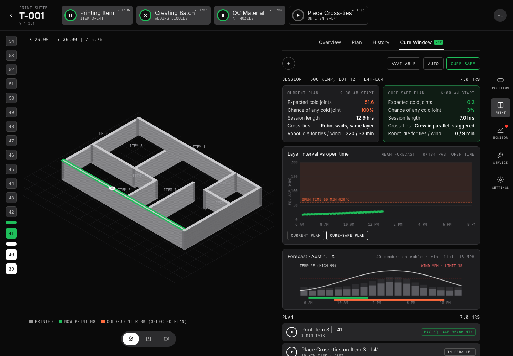

# Cure Window for ICON BuildOS

**Live demo:** https://mohith26.github.io/icon-cure-window/

An unofficial concept feature for ICON's Print Suite: **plan each print session around the weather forecast and concrete curing so no wall waits past its open time between layers.**

Every wall item is printed one layer at a time. If the robot comes back to a wall too late, the layer below has stiffened past its open time and the next bead doesn't bond well (a cold joint). If it comes back too early, the layer below can't carry the load yet. Both limits move with temperature, and Titan holds when sustained wind passes 18 mph, which stretches intervals. Cross-tie tasks matter a lot too: if every item gets ties on the same layer and the robot waits for each, that round takes 96 minutes.



## What the demo shows
- A **Cure Window** tab in the Print Suite (next to Overview / Plan / History) for printer T-001, session L41-L64 on a synthetic 8-item, ~2,000 sq ft plan.
- **Current plan vs Cure-safe plan:** expected cold joints, chance of any cold joint, session length, robot idle time, all averaged over a 40-member forecast ensemble.
- **Layer interval vs open time:** every item-layer interval in equivalent age, against the open-time line, for either plan.
- **Forecast:** hourly temperature and wind (median and 90th percentile) with Titan's 18 mph limit and both plans' time windows.
- The recommended task list in the Print Suite's own format ("Print Item 3 | L41", "Place Cross-ties on Item 3 | L41 · crew in parallel").

Result on the synthetic hot-day job: current plan (9:00 AM, ties on the same layer, robot waits) **51.6 expected cold joints, 12.9 h**; cure-safe plan (6:00 AM, staggered tie layers, crew ties in parallel) **0.2 expected cold joints, 3% chance of any, 7.0 h**. A fairer baseline (parallel crew, same-layer ties, 9:00 AM) still expects 41.6. These are recomputed live in the page.

## How it works (`cureplan.js`)
1. **Maturity method.** Curing is tracked as equivalent age at 20 °C: `te = ∫ exp(Ea/R · (1/293.15 − 1/T)) dt` with Ea = 33.5 kJ/mol. A cumulative table at 1-minute resolution makes every interval query O(1).
2. **Exact event simulation** of a plan for one weather trace: travel between items (Titan's 20 in/s travel), wind holds above 18 mph, buildability waits (binary search for the moment `te` reaches the minimum), cross-tie handling (robot waits / batch at round end / one crew in parallel with a "ties must be in before the next layer" constraint), and per-item cross-tie phase.
3. **Risk** = the simulation over 40 forecast members (temperature bias + AR(1) noise, log-normal wind scale) → probability of a cold joint for every item-layer and the expected count.
4. **Search** over start time × cross-tie policy × item order (2-opt tour and its rotations and reverses) × tie phase (same layer vs staggered), then pairwise swaps of the best order, minimizing expected cold joints plus a small session-length penalty.

## Tests
```
node --test test/*.test.js
```
9 tests: maturity rate, exact equivalent age, the wait solver, heat turning a safe interval into a cold joint, buildability waits, wind holds, staggered vs aligned ties, optimizer never worse than a representable baseline, tour validity.

## Honest limitations
- **Material numbers are assumptions**, not FormCrete data: open time 60 min and minimum interval 8 min at 20 °C, Ea = 33.5 kJ/mol. The planner takes them as inputs. They should be calibrated with ICON's own interlayer bond tests.
- The plan, path lengths (≈3.1× wall length per layer for two beads plus infill), cross-tie cadence (every 6 layers, 10 min) and forecast are synthetic. Titan specs (wind limit, travel speed) are from ICON's public spec page.
- Cold joint is a threshold on equivalent age. Real interlayer bond strength degrades gradually and also depends on humidity, sun and surface moisture.
- The current-plan baseline (robot waits for each tie) may be harsher than what crews actually do. The README and the page also report the parallel-crew baseline.
- The 3D view is a simple isometric extrusion, not BuildOS's renderer.

## Novelty note
ICON says BuildOS orchestrates tool paths, robotics, material delivery and "environmental inputs", and Titan's program lists site layout, material planning and print sequencing. I found no public description of forecast-ensemble cold-joint risk, maturity-based interval limits, or cross-tie phase staggering in ICON's site, newsroom or job posts. The maturity method and layer-interval limits are well known in the concrete 3D printing literature. Running them as an optimizing planner inside the operator's task list is the new part.

---
Unofficial concept demo by Mohith Gajjela. Not affiliated with ICON. Synthetic data; material parameters are assumptions.
